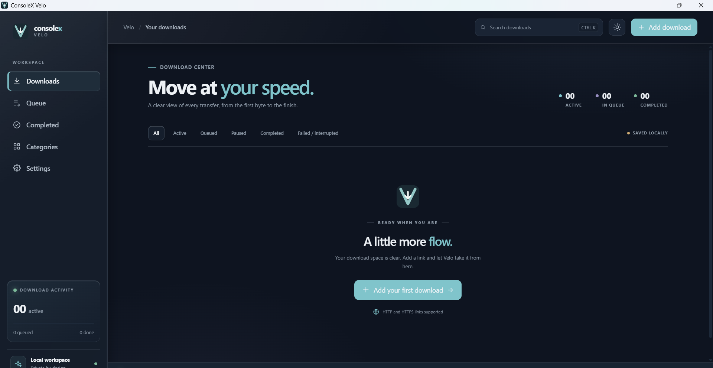

# ConsoleX Velo

ConsoleX Velo is a Windows-first desktop download manager. The UI is a Tauri 2 webview built with React and TypeScript; the native Rust application service calls the existing independent Rust download engine.

## ScreenShot



## Run locally

Prerequisites: Node.js/npm, Rust with the MSVC Windows target and Visual C++ Build Tools, and the WebView2 runtime/development prerequisites required by Tauri.

```powershell
npm install
npm run tauri dev
```

The frontend-only development server is available with `npm run dev`; native commands and download transfers require the Tauri application.

## Checks

```powershell
npm test
npm run build
cargo fmt --check
cargo check
cargo test
cargo clippy --all-targets --all-features -- -D warnings
cargo fmt --manifest-path src-tauri/Cargo.toml --check
cargo check --manifest-path src-tauri/Cargo.toml
cargo test --manifest-path src-tauri/Cargo.toml
cargo clippy --manifest-path src-tauri/Cargo.toml --all-targets --all-features -- -D warnings
```

The native Tauri crate depends on the root `consolex-download-engine` library by path, keeping engine tests independent of Tauri and the webview.

## Current product limits

HTTP and HTTPS are supported with queueing, bounded concurrency, pause/resume, and durable local history (URLs DPAPI-protected). Interrupted transfers restart across app launches: when the server supports strong validators, the retry continues from the last verified checkpoint; otherwise it restarts from byte zero. Transient network failures are retried automatically with a bounded, backed-off schedule (cancellations and permanent failures are never retried automatically). Segmented (multi-stream) transfers, categories, and file-opening actions are not available.

See [the architecture](docs/ARCHITECTURE.md), [security requirements](docs/SECURITY_AND_PRIVACY.md), and [roadmap](docs/ROADMAP.md) for boundaries and remaining release work.
