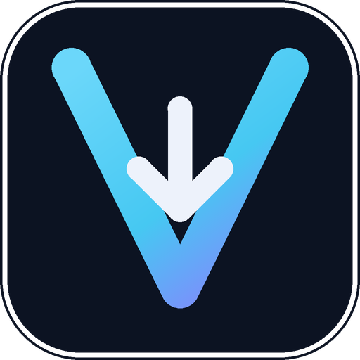

 <div align="center">

  

  # Velo

  ### Move files. Not limits.

  **A modern, high-performance download manager built with Rust and Tauri.**

  Reliable downloads, intelligent scheduling, and a refined desktop experience — all in one lightweight application.

  <p>
    <a href="https://github.com/ConsoleX-ir/Velo/releases">
      
    </a>
    <a href="https://github.com/ConsoleX-ir/Velo/blob/main/LICENSE">
      
    </a>
    <a href="https://github.com/ConsoleX-ir/Velo">
      
    </a>
    <a href="https://github.com/ConsoleX-ir/Velo/issues">
      
    </a>
  </p>

  <p>
    
    
    
    
    
  </p>

  <p>
    <a href="#-features">Features</a> •
    <a href="#-screenshots">Screenshots</a> •
    <a href="#-installation">Installation</a> •
    <a href="#-development">Development</a> •
    <a href="#-architecture">Architecture</a>
  </p>

</div>

---

## ✨ About Velo

Velo is a modern desktop download manager designed around one simple idea: **downloads should be fast, reliable, and effortless to manage.**

Powered by a native Rust download engine and a React-based interface, Velo combines efficient network operations with a carefully designed desktop experience.

From concurrent HTTP transfers and automatic retries to persistent recovery and intelligent scheduling, Velo is built to handle downloads without unnecessary complexity.

It is designed to be lightweight, responsive, and practical — without sacrificing control over your downloads.

## 🚀 Features

<table>
  <tr>
    <td width="50%">
      <h3>⚡ High-Performance Engine</h3>
      <ul>
        <li>Native Rust download engine</li>
        <li>Concurrent HTTP Range transfers</li>
        <li>Server-aware transfer validation</li>
        <li>Configurable bandwidth limits</li>
        <li>Unlimited speed mode</li>
      </ul>
    </td>
    <td width="50%">
      <h3>📥 Smart Download Management</h3>
      <ul>
        <li>Automatic queue management</li>
        <li>Configurable concurrency</li>
        <li>Pause, resume, cancel, and retry</li>
        <li>Download scheduling</li>
        <li>Persistent download history</li>
      </ul>
    </td>
  </tr>
  <tr>
    <td width="50%">
      <h3>🧠 Intelligent Experience</h3>
      <ul>
        <li>Clipboard URL detection</li>
        <li>URL inspection before downloading</li>
        <li>Automatic metadata extraction</li>
        <li>Redirect-aware inspection</li>
        <li>Automatic retry for transient failures</li>
      </ul>
    </td>
    <td width="50%">
      <h3>🖥️ Native Desktop Integration</h3>
      <ul>
        <li>System tray integration</li>
        <li>Minimize to tray</li>
        <li>Launch at startup</li>
        <li>Native desktop notifications</li>
        <li>Persistent application settings</li>
      </ul>
    </td>
  </tr>
</table>

### ⚡ Download Engine

Velo uses a Rust-based engine to manage HTTP and HTTPS transfers.

- **Concurrent transfers:** Uses multiple validated HTTP Range requests when supported by the server.
- **Safe continuation:** Validates server responses and entity information before continuing interrupted transfers.
- **Automatic recovery:** Supports persistent download metadata and recovery across application restarts.
- **Smart scheduling:** Manages active and queued downloads automatically.
- **Bandwidth control:** Supports global and per-download speed limits.
- **Unlimited mode:** Avoids artificial speed restrictions when unlimited mode is selected.

### 🎨 Desktop Experience

Velo features an Industrial Futurism-inspired interface with a focus on clarity, responsiveness, and visual character.

- Dark and light themes.
- Compact download cards.
- Live download speed visualizations.
- Responsive layouts.
- Organized settings and controls.
- Native desktop interactions.

---

## 🖼️ Screenshots

<div align="center">

  <!-- Add real Velo 0.7 screenshots here -->

  | Main Window | Download Management |
  |:---:|:---:|
  |  |  |

  | Add Download | Settings |
  |:---:|:---:|
  |  |  |

</div>

> Replace the screenshot paths above with actual screenshots from the Velo 0.7 build before publishing.

---

## 📦 Installation

Prebuilt packages are intended to be distributed through the GitHub repository.

**Supported package formats:**

| Platform | Package | Format |
|---|---|---|
| Windows | NSIS Installer | `.exe` |
| Linux | AppImage | `.AppImage` |
| Linux | Debian Package | `.deb` |

### Windows

1. Download the latest Windows installer.
2. Run the `.exe` installer.
3. Follow the installation wizard.
4. Launch Velo from the Start Menu.

**Requirements**
- Windows 10 or later.
- WebView2 Runtime.
- x64 architecture for the current Windows build.

### Linux — AppImage

```bash
chmod +x Velo-0.7.0.AppImage
./Velo-0.7.0.AppImage
```

### Linux — Debian / Ubuntu

```bash
sudo apt install ./Velo-0.7.0.deb
```

After installation, launch Velo from your desktop application launcher.

> Linux runtime requirements can vary depending on your distribution and desktop environment.

### 📂 Installer Directory

Generated installers are organized in the repository root:

```text
installer/
├── Velo-0.7.0-Windows-Setup.exe
├── Velo-0.7.0-Linux.AppImage
└── Velo-0.7.0-Linux.deb
```

Actual filenames should match the generated release artifacts.

---

## 🛠️ Development

Want to build Velo from source? Follow the instructions below.

### Prerequisites

| Tool | Requirement |
|---|---|
| Node.js | 22.12+ or supported 24.x / 26+ |
| npm | Compatible with the installed Node.js version |
| Rust | Stable toolchain |
| Tauri | Tauri 2 prerequisites |

For Linux development, install the required system dependencies:

```bash
sudo apt update

sudo apt install \
  libwebkit2gtk-4.1-dev \
  libgtk-3-dev \
  libayatana-appindicator3-dev \
  librsvg2-dev \
  libssl-dev \
  pkg-config \
  build-essential
```

### Clone the Repository

```bash
git clone https://github.com/ConsoleX-ir/Velo.git

cd Velo
```

### Install Dependencies

```bash
npm ci
```

### Run Development Server

```bash
npm run tauri dev
```

### Build Frontend

```bash
npm run build
```

### Build Production Application

```bash
npm run tauri build
```

Generated application bundles are available under:

```text
src-tauri/target/release/bundle/
```

---

## 📦 Building Installers

Velo includes dedicated scripts for building platform-specific installers.

### Windows

Run PowerShell from the project root:

```powershell
powershell -ExecutionPolicy Bypass -File scripts\build-windows-installer.ps1
```

To skip prerequisite checks:

```powershell
powershell -ExecutionPolicy Bypass -File scripts\build-windows-installer.ps1 -SkipChecks
```

### Linux

Run on a supported Linux distribution:

```bash
bash scripts/build-linux-installer.sh
```

To skip prerequisite checks:

```bash
bash scripts/build-linux-installer.sh --skip-checks
```

### Linux Through WSL

Windows users can build Linux packages through WSL:

```powershell
powershell -ExecutionPolicy Bypass -File scripts\build-linux-wsl.ps1
```

The WSL script uses a Linux environment to generate Linux-native packages.

---

## 🏗️ Architecture

Velo uses a native backend and a modern web-based desktop frontend.

```text
                   ┌──────────────────────────┐
                   │       Velo Desktop       │
                   └────────────┬─────────────┘
                                │
                   ┌────────────▼─────────────┐
                   │       React + TS         │
                   │       User Interface     │
                   └────────────┬─────────────┘
                                │
                         Tauri IPC / Events
                                │
                   ┌────────────▼─────────────┐
                   │         Rust             │
                   │     Application Layer    │
                   └────────────┬─────────────┘
                                │
             ┌──────────────────┼──────────────────┐
             │                  │                  │
     ┌───────▼────────┐ ┌───────▼────────┐ ┌───────▼────────┐
     │ Download       │ │ Scheduler &   │ │ Persistence    │
     │ Engine         │ │ Manager        │ │ & Recovery     │
     └───────┬────────┘ └────────────────┘ └────────────────┘
             │
     ┌───────▼────────┐
     │ HTTP / HTTPS   │
     │ Network Layer  │
     └────────────────┘
```

### Technology Stack

| Layer | Technology |
|---|---|
| Desktop Runtime | Tauri 2 |
| Backend | Rust |
| Frontend | React |
| Language | TypeScript |
| Build Tool | Vite |
| Styling | Tailwind CSS v4 |
| HTTP Client | Reqwest |
| Package Manager | npm |

---

## 🧪 Testing

Velo includes separate test suites for its Rust engine, Tauri backend, and frontend.

### Rust Engine

```bash
cargo test
```

### Tauri Backend

```bash
cargo test --manifest-path src-tauri/Cargo.toml
```

### Frontend

```bash
npx vitest run
```

### Formatting

```bash
cargo fmt --all -- --check

cargo fmt --manifest-path src-tauri/Cargo.toml -- --check
```

### Clippy

```bash
cargo clippy --all-targets --all-features -- -D warnings

cargo clippy \
  --manifest-path src-tauri/Cargo.toml \
  --all-targets \
  --all-features \
  -- -D warnings
```

### Production Build

```bash
npm run build
cargo build --release
```

---

## 🔐 Security & Privacy

Velo follows several important security principles:

- HTTPS downgrade prevention during supported redirect handling.
- Validation of HTTP Range responses.
- Safe handling of temporary download files.
- Validation of download destinations.
- Graceful handling of malformed server metadata.
- Avoiding sensitive download URLs in desktop notifications.

Velo does not assume every server supports concurrent or resumable downloads. Transfer strategies depend on server capabilities and response validation.

If you discover a security vulnerability, please report it privately to the project maintainers rather than publishing exploit details in a public issue.

---

## 🗺️ Roadmap

Velo is developed incrementally, with reliability and performance as its primary engineering goals.

| Area | Status |
|---|---|
| Rust Download Engine | Implemented |
| Download Scheduling | Implemented |
| Persistent Recovery | Implemented |
| Desktop UI | Implemented |
| Smart Download Experience | Implemented |
| Native Desktop Integration | Implemented |
| Performance Optimization | Implemented; profiling validation pending |
| Windows & Linux Packaging | Existing build infrastructure; final validation pending |
| Production Release | In progress |

Future protocol support, including BitTorrent, is considered a separate architectural decision.

---

## 🤝 Contributing

Contributions, bug reports, and suggestions are welcome!

If you want to contribute:

1. Fork the repository.
2. Create a feature branch.
3. Make your changes.
4. Add or update tests where appropriate.
5. Run the relevant checks.
6. Submit a pull request with a clear description.

Please keep contributions focused and consistent with the existing architecture.

---

## ❓ FAQ

<details>
<summary><strong>Does Velo support BitTorrent?</strong></summary>

No. Velo currently focuses on HTTP and HTTPS downloads. BitTorrent is outside the current release scope.
</details>

<details>
<summary><strong>Does Velo support unlimited download speed?</strong></summary>

Yes. Velo provides an unlimited speed mode without artificial throttling.
</details>

<details>
<summary><strong>Can Velo resume interrupted downloads?</strong></summary>

Velo supports persistent recovery and validated continuation when the local file state and server response permit it. Otherwise, it uses a safe fallback.
</details>

<details>
<summary><strong>Does Velo work on Linux?</strong></summary>

Linux packages are targeted through AppImage and Debian formats. Compatibility depends on the target distribution and its runtime dependencies.
</details>

<details>
<summary><strong>Is Velo open source?</strong></summary>

Check the repository's license file for the exact licensing and redistribution terms.
</details>

---

## 📌 Project Links

<p align="center">
  <a href="https://github.com/ConsoleX-ir/Velo">GitHub Repository</a> •
  <a href="https://github.com/ConsoleX-ir/Velo/issues">Issue Tracker</a> •
  <a href="https://github.com/ConsoleX-ir/Velo/releases">Releases</a>
</p>

---

<div align="center">

  <h2>Velo</h2>

  **Move files. Not limits.**

  Built with Rust, Tauri, and React.

  <sub>© ConsoleX — Velo Project</sub>

</div>